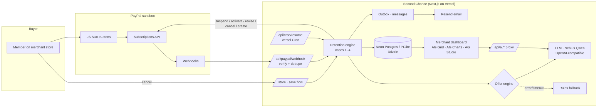

# Second Chance

**An AI retention agent for PayPal Subscriptions merchants.** It saves cancellations, recovers failed payments, and wins back churned subscribers, then shows the merchant exactly what it saved.

Built for the PayPal AI Hackathon (2026). The demo merchant is **Brightside Yoga**, a fictional studio running on the PayPal sandbox.

**Live demo:** https://second-chance-k12-4d00.vercel.app · Project status: [docs/STATUS.md](docs/STATUS.md)


## Try it (for judges)

No accounts or PayPal login needed. Everything runs on the PayPal sandbox.

1. **Cancel as a member.** Open [/store/account](https://second-chance-k12-4d00.vercel.app/store/account) and sign in as a practice member: **Maya Chen** (14 months), **Leo Park** (2 months) or **Ava Ruiz** (7 months). Choose *Cancel membership*, pick a reason, and Second Chance shows one offer written for that member by the AI. A **"Demo · what Second Chance decided"** panel shows the model, the offer and why. Accept it, decline it, or *Cancel without an offer*.
2. **See the real email.** On the offer (or any Outbox message), use **Email this to me**: the branded email arrives from `offers@secondchance.heyremind.ai`.
3. **Fire PayPal events.** In the [demo console](https://second-chance-k12-4d00.vercel.app/dashboard/demo), send signed sandbox webhooks (payment failed, suspended, cancelled in PayPal, payment received) and watch cases 1, 3 and 4 run. *Reset practice members* and *Reset* restore the demo.
4. **Look at the merchant side.** [Dashboard](https://second-chance-k12-4d00.vercel.app/dashboard) → Subscribers, Offers & revenue, Outbox, Events, and [Studio](https://second-chance-k12-4d00.vercel.app/dashboard/studio) → *Ask AI*: "Who should I call today?"

Demo actions, AI calls and emails have light per-visitor limits (see [Limits](#limits)); normal judging never hits them.

## The problem

Subscription businesses lose a large share of revenue to churn, and much of it is avoidable. Some subscribers leave because a card failed. Others just needed a break, or a cheaper plan. Most small merchants on PayPal Subscriptions have no retention tooling. A cancel is just a cancel, a failed payment is just an email from PayPal, and nobody follows up with a churned subscriber.

## What Second Chance does

Second Chance listens to the merchant's PayPal subscription webhooks and adds a save flow to their cancel button. When a subscriber is about to leave, it:

1. **Picks one offer** that fits the situation: pause, discount, downgrade, win-back, payment recovery, or a graceful goodbye.
2. **Writes a short, personal message** for it.
3. **Applies the offer through the PayPal Subscriptions API**: suspend/activate, revise to another plan, or a new subscription with a per-subscriber price override.
4. **Tracks the outcome** from PayPal webhooks and reports MRR saved, save rate, and which offers work for which churn signal.

### The four cases

| # | Trigger | What happens |
|---|---|---|
| 1 | `BILLING.SUBSCRIPTION.PAYMENT.FAILED` | The member is marked at risk with a 7-day grace period and gets a recovery message. `PAYMENT.SALE.COMPLETED` closes it as saved |
| 2 | Cancel on the merchant's site | Save flow: reason → offer → result (or *Cancel without an offer*, `POST /api/save/cancel`, so the flow never traps anyone). **Pause** suspends in PayPal (no consent needed). **Discount** revises to the Save50 plan. **Downgrade** revises to Lite. The buyer confirms both in PayPal. Declining cancels in PayPal |
| 3 | `BILLING.SUBSCRIPTION.SUSPENDED` (not started by us) | A come-back message; one tap calls `/activate` |
| 4 | `BILLING.SUBSCRIPTION.CANCELLED` (not started by us) | Win-back: a new subscription on the Win-back plan with the offer price as a plan override, sent as a one-tap approve link. `ACTIVATED` with `custom_id=winback:<old>:<offer>` marks it saved |

Paused subscriptions resume automatically. A daily Vercel Cron (`/api/cron/resume`, 10:00 UTC; Vercel Hobby allows one run per day) reactivates every subscription whose pause has ended.

| Save offer | Win-back landing | AI-written offer log |
|---|---|---|
|  |  |  |

## PayPal APIs used

| API | Used for |
|---|---|
| `POST /v1/oauth2/token` | Client-credentials auth (secret read from the environment only) |
| JS SDK Buttons (`intent=subscription`, `vault=true`) | Subscribe buttons on the merchant store |
| `GET /v1/billing/subscriptions/{id}` | Sync status, plan and billing info, and reconcile after buyer consent |
| `POST …/suspend`, `POST …/activate` | Pause offers, come-back reactivation, auto-resume |
| `POST …/revise` | Discount (Save50 plan) and downgrade (Lite plan), with an approve link for buyer consent |
| `POST …/cancel` | When the member declines every offer |
| `POST /v1/billing/subscriptions` (with `plan` override) | Win-back at a per-subscriber price |
| `POST /v1/notifications/verify-webhook-signature` | Every webhook is verified before it is acted on |
| `POST /v1/notifications/simulate-event` | Demo console: fire real, signed sandbox events |
| Catalog / Plans APIs (`tools/paypal-spikes`) | One-time setup of the product and the Pro, Lite, Save50 and Win-back plans |

Webhooks are de-duplicated by event id. Every event is stored, but unverified ones are never acted on. Status changes we caused ourselves are recorded and ignored.

## How AI is used

- **Model:** Nebius AI Studio `Qwen/Qwen3-30B-A3B-Instruct-2507` in production (`LLM_PROVIDER=nebius`), for both the offer engine and the Studio analyst.
- **Offer engine** (`app/src/lib/offers/`): an LLM picks the offer kind, price, duration and message from the member's context (plan, tenure, payment history, cancel reason, trigger). Every decision is clamped by guardrails: price never below 40% of list, discounts at most 6 months, pauses at most 3 months, and a per-trigger list of allowed offers. Any error or timeout falls back to a deterministic **rules** engine, so the app works with no AI key at all.
- **"Ask the grid"** (AG Grid AI Toolkit): merchants type plain English ("members over 12 months tenure that we lost, grouped by plan") and the grid's filters, grouping and sorting change to match. Undo is one click.
- **AI analyst in AG Studio**: an agent built on the AG Studio agent framework, with two custom tools (`list_at_risk_members`, `retention_playbook`). It answers "Who should I call today?", recommends the best offer per churn signal, and hands work to Studio's built-in agents to add charts or explain a page.

Any OpenAI-compatible provider works (Nebius AI Studio, OpenAI, xAI, or a custom endpoint). Keys stay on the server. The Studio analyst calls the model through `/api/ai/responses`, a proxy with a model allow-list.

## AG Grid, AG Charts and AG Studio

| Where | What |
|---|---|
| Overview (`/dashboard`) | AG Charts combo chart (stacked weekly MRR saved per offer + cumulative line) and a donut, plus two live compact grids |
| Subscribers | AG Grid Enterprise: row grouping with a group bar, saved views, **master/detail** (PayPal event timeline, offer history, member card), **sparklines** of 12 months of payments, set filters, side bar, status bar, CSV/Excel export, live updates with cell flash, and the **AI Toolkit** |
| Offers & revenue | **Pivot mode** (trigger × offer) with switchable measures (MRR saved, offers made, a custom save-rate aggregation, % of trigger) and a linked **integrated pivot chart** |
| Event timeline | Every PayPal webhook with signature status, grouped views and quick filter |
| Studio (`/dashboard/studio`) | **AG Studio** with three pages (Retention, Members, PayPal webhooks), a relational data model (subscribers ↔ offers ↔ events + calendar), a custom **Save-flow Sankey** widget (AG Charts, cross-filtering), a matching theme, and the **AI analyst** |

All grids share one Quartz theme (`app/src/components/grid/ag-setup.ts`) tuned to the app's stone and teal palette.

| Subscribers + detail | Pivot + integrated chart | AG Studio AI analyst |
|---|---|---|
|  |  |  |

## Architecture



## Repository layout

```
app/                  Next.js 16 app (the whole product). Vercel Root Directory = app
  src/app/            Routes: /store, /dashboard/*, /api/*
  src/lib/            PayPal client, retention engine, offer engines, DB (Drizzle)
  src/components/     UI, AG Grid views, AG Studio (data model, theme, Sankey, AI)
  scripts/            Playwright screenshot scripts, email self-test and template renderer
  vercel.json         Cron schedule for auto-resume
tools/paypal-spikes/  The sandbox spikes: webhook receiver, catalog/plan setup, revise, win-back, simulator
docs/STATUS.md        Done, remaining work, known caveats
docs/DEPLOY.md        How production is deployed (Vercel + Neon + PayPal + Resend)
docs/DECISIONS.md     Short decision log
docs/screenshots/     Screenshots
.env.example          Every environment variable, with placeholders
```

## Run it locally

Requires Node 20+.

```bash
git clone https://github.com/k7bot/second-chance && cd second-chance
cp .env.example app/.env.local      # fill in your PayPal sandbox app + plan ids
cd app
npm install
npm run dev                         # or: npx next build && npx next start
```

Open http://localhost:3000. The database is created on first use: embedded PGlite in `app/.data/`, or Neon when `DATABASE_URL` is set. No migration step is needed.

**PayPal setup (once):** create a sandbox REST app, then use the scripts in `tools/paypal-spikes` to create the product and plans and to register the webhook. They write the ids to `.env.sandbox` at the repo root (git-ignored), which the app also reads; or copy them into `app/.env.local`. `setup-catalog.js` and `setup-offer-plans.js` create the plans, and `setup-webhook.js <url>` registers the webhook.

**Webhooks locally:** point the PayPal webhook at a [smee.io](https://smee.io) channel and relay it:

```bash
npx smee-client -u https://smee.io/<your-channel> -t http://localhost:3000/api/paypal/webhook
```

On Vercel, point the webhook straight at `https://<app>.vercel.app/api/paypal/webhook`.

## Deploy

**Simple path:** import the repo in Vercel, set **Root Directory** to `app`, add the env vars from `.env.example`, and set `DATABASE_URL` to a Neon database. The cron in `app/vercel.json` is picked up automatically. Point the PayPal webhook at `https://<app>.vercel.app/api/paypal/webhook`.

**How the hosted demo is deployed today:** the project is not Git-linked, so each deploy uploads a packed archive of the committed `app/` tree through the Vercel API, with a custom install command that unpacks it. File paths in the upload need the `app/` prefix because Root Directory is `app`. Secrets are pasted into the Vercel UI by hand. Full steps: [docs/DEPLOY.md](docs/DEPLOY.md).

## Environment variables

See [`.env.example`](.env.example).

| Var | Required | Purpose |
|---|---|---|
| `PAYPAL_CLIENT_ID`, `PAYPAL_CLIENT_SECRET` | yes | Sandbox REST app. The secret is read from the environment only and never logged |
| `PAYPAL_API_BASE` | no | Defaults to `https://api-m.sandbox.paypal.com` |
| `PAYPAL_WEBHOOK_ID` | yes | Used to verify webhook signatures |
| `PAYPAL_PRODUCT_ID`, `PAYPAL_PLAN_PRO_ID`, `PAYPAL_PLAN_LITE_ID`, `PAYPAL_PLAN_SAVE50_ID`, `PAYPAL_PLAN_WINBACK_ID` | yes | Catalog created by `tools/paypal-spikes` |
| `APP_BASE_URL` | no | Used in return URLs and message links (default `http://localhost:3000`) |
| `DATABASE_URL` | no | Neon Postgres. Without it, embedded PGlite is used |
| `CRON_SECRET` | no | If set, `/api/cron/resume` requires `Authorization: Bearer <secret>` |
| `OFFER_ENGINE` | no | `auto` (default), `llm` or `rules` |
| `LLM_PROVIDER` | no | `nebius`, `openai`, `xai` or `custom` to pin a provider. Empty = auto (custom, then OpenAI, xAI, Nebius, by which key is set). Production: `nebius` |
| `NEBIUS_API_KEY` / `OPENAI_API_KEY` / `XAI_API_KEY` | no | Any one enables the AI offer engine and the Studio analyst (secret) |
| `LLM_API_KEY`, `LLM_BASE_URL`, `LLM_MODEL`, `LLM_TIMEOUT_MS` | no | Any other OpenAI-compatible endpoint, plus model and timeout overrides (Nebius default model: `Qwen/Qwen3-30B-A3B-Instruct-2507`) |
| `STUDIO_AI_MODELS` | no | Comma-separated models the Studio analyst may call (default: Qwen/Qwen3-30B-A3B-Instruct-2507 on Nebius, else an OpenAI mini model) |
| `STUDIO_AI_MODEL` | no | Single-model override for the Studio analyst (used when `STUDIO_AI_MODELS` is empty) |
| `LLM_IP_HOURLY_LIMIT` | no | AI calls (offers, Studio analyst, grid AI) per visitor IP per hour, default `60`; over it offers quietly use the rules engine and the analyst says it is resting |
| `LLM_DAILY_LIMIT` | no | AI calls per day across the app; code default `1500`, hosted production/preview override `300` (Vercel plain-variable metadata checked Nov 7, 2026 ET; no secrets decrypted) |
| `DEMO_IP_HOURLY_LIMIT` | no | Demo console reset / practice members / sample history, per visitor IP per hour, default `10` |
| `DEMO_PAYPAL_IP_HOURLY_LIMIT` | no | Simulator, import, reactivate and reconcile calls per visitor IP per hour, default `30` |
| `DEMO_REAL_IP_HOURLY_LIMIT` / `DEMO_REAL_DAILY_LIMIT` | no | Suspend/cancel of real sandbox subscriptions: default `5` per visitor IP per hour and `20` per day; only subscriptions the console lists. `Authorization: Bearer $CRON_SECRET` skips the demo limits |
| `RATE_LIMIT_SALT` | no | Salt for hashing visitor IPs in `rate_limits` (defaults to `CRON_SECRET`) |
| `RESEND_API_KEY` | no | Turns on real email through Resend's REST API (store it as a sensitive variable). Without it, or without `EMAIL_FROM`, every message stays in the outbox |
| `EMAIL_FROM` | no | Sender on a verified Resend domain, e.g. `Brightside Yoga <offers@secondchance.heyremind.ai>` |
| `EMAIL_REPLY_TO` | no | Reply-to address; when set, emails also say "just reply to this email" |
| `EMAIL_IP_HOURLY_LIMIT` / `EMAIL_DAILY_LIMIT` | no | "Email this to me" sends for practice members: default `5` per visitor IP per hour and `50` per day across the app |
| `NEXT_PUBLIC_AG_GRID_LICENSE_KEY` | no | AG Grid + AG Charts Enterprise. Without it a watermark is shown |
| `NEXT_PUBLIC_AG_STUDIO_LICENSE_KEY` | no | AG Studio. Without it Studio runs in trial mode with a watermark |
| `PGLITE_DIR`, `SC_ENV_FILE` | no | Local only: PGlite data directory (default `app/.data/pglite`) and an alternate env file (default `../.env.sandbox`) |

The hosted demo sets `NEXT_PUBLIC_AG_GRID_LICENSE_KEY` to a 30-day AG Grid Enterprise trial key that expires Dec 2, 2026; judging runs Dec 1–15, 2026 ET, so this expires during judging. Previous vendor confirmation says expiry is watermark-only, not a functionality cutoff; that is historical confirmation, not independently verified post-expiry behavior. Re-check before judging. Never commit real values: secrets go into the Vercel UI only (see [docs/DEPLOY.md](docs/DEPLOY.md)).

## Limits

Light abuse protection (`app/src/lib/guard.ts`) keeps a public demo with a paid AI key and real email safe:

- Fixed-window counters live in the Postgres `rate_limits` table, so they hold across serverless instances. Visitor IPs are stored only as salted SHA-256 hashes.
- **AI:** 60 calls per visitor IP per hour; code default 1,500 per day across the app, overridden to **300/day on hosted production and preview** (Vercel metadata verified Nov 7, 2026 ET, without decrypting secrets). Over the cap, offers quietly use the rules engine and the Studio analyst says it is resting.
- **Demo console:** 10 resets/seeds per IP per hour, 30 PayPal simulator/import/reconcile calls per IP per hour, 5 real-subscription actions per IP per hour (20 per day).
- **Email this to me:** 5 per IP per hour, 50 per day.
- The limiter **fails open**: if the counter table errors, the request goes through. `Authorization: Bearer $CRON_SECRET` (the operator) skips the demo limits.

## Email

Messages are written to the outbox first, then sent through [Resend](https://resend.com/docs/api-reference/emails/send-email) (`POST https://api.resend.com/emails`, no SDK) when `RESEND_API_KEY` and `EMAIL_FROM` are both set. The Outbox page shows each message's delivery status (*Sent* with the Resend id, *Failed* with the error, or *Outbox only* with the reason) and the address it went to, masked.

- **Templates** (`app/src/lib/email/templates.ts`): one branded layout in HTML and plain text, with a single call-to-action button that links back into the app (`APP_BASE_URL`). It covers failed-payment recovery, the save offer, the come-back after a suspension, the win-back after a cancel in PayPal, and confirmations (paused, new price, waiting on PayPal, cancelled).
- **Who gets real email:** only real sandbox buyers whose address is not a placeholder (`@example.com` and similar stay in the outbox). Practice (`DEMO-`), sample (`SAMPLE-`) and simulator members never send to their placeholder addresses.
- **Email this to me:** for those placeholder members a visitor can type their own address and get the real email. Limits are 5 per IP per hour and 50 per day, the address is checked, and only a masked form is stored.
- **Offline check:** `npx tsx scripts/email-selftest.ts` (stubbed fetch, throwaway database, no key) and `npx tsx scripts/render-emails.ts <dir>` to render every template to HTML.

## Demo walkthrough

1. **Store** (`/store`): Brightside Yoga's plans, each with a PayPal subscribe button.
2. **Cancel** (`/store/account` → *Cancel membership*): pick a reason ("too expensive", "taking a break"…). Second Chance shows one tailored offer. Accept it and PayPal is updated: a pause is instant, a discount or downgrade asks for buyer consent.
3. **Demo console** (`/dashboard/demo`): fire signed PayPal sandbox events (payment failed, suspended, cancelled in PayPal, payment received), or replay them. Watch each case run, and the outbox fill with AI-written recovery, come-back and win-back messages. With email switched on, *Email this to me* on any outbox message (or on the offer in the practice cancel flow) sends you the real branded email.
4. **Dashboard** (`/dashboard`): MRR saved, save rate, who needs attention, and live webhooks.
5. **Subscribers / Offers**: group the retention queue, open a member's PayPal timeline, pivot offers by churn signal, and ask the grid in plain English.
6. **Studio** (`/dashboard/studio`): the save-flow Sankey, then *Build · Ask AI* → "Who should I call today?"

## Sandbox and sample data

- Everything runs against the **PayPal sandbox**. No real money moves and no SMS is sent. Every message is recorded in the in-app outbox; real email goes out only when Resend is configured (see [Email](#email)).
- **Practice members** (`DEMO-*`) run the full save flow with no PayPal calls, so the hosted demo works without a sandbox buyer login.
- **Sample history** (`SAMPLE-*` ids, verification `SAMPLE`) is a clearly labelled synthetic book of business. It gives the grids, pivots and Studio months of history to show. Load or clear it from the demo console. It never touches PayPal, and live sandbox data stays separate.
- `/dashboard` has no auth: this is a single-merchant demo.

## Known PayPal behaviour

- A price override on the *same* plan is refused (`OVERRIDES_ON_SAME_PLAN_NOT_ALLOWED`), so discounts revise to a separate Save50 plan.
- Revise is refused while a subscription is SUSPENDED.
- A revise still awaiting buyer consent makes `/activate` fail with `422 SESSION_STATE_NOT_VALID`. The app refuses to pause while a revise is pending.
- Simulator events reuse one event id per type, so a repeat is de-duplicated. Use **Replay** in the demo console instead.
- `PAYMENT.FAILED` simulation must be sent without `resource_version`.
- Webhooks lag the API by 10–20 s, so the UI trusts the API response.

## License

[MIT](LICENSE) © 2026 Kiran Karnati
